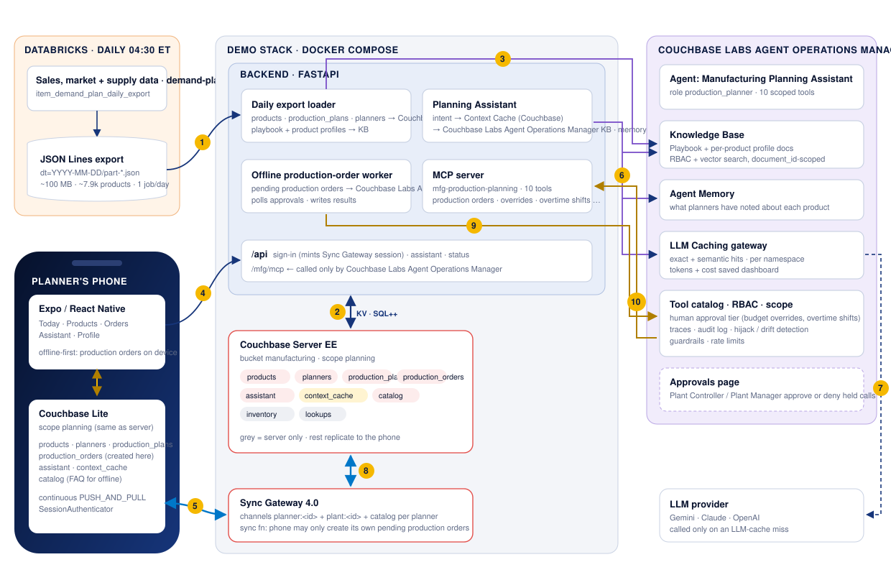
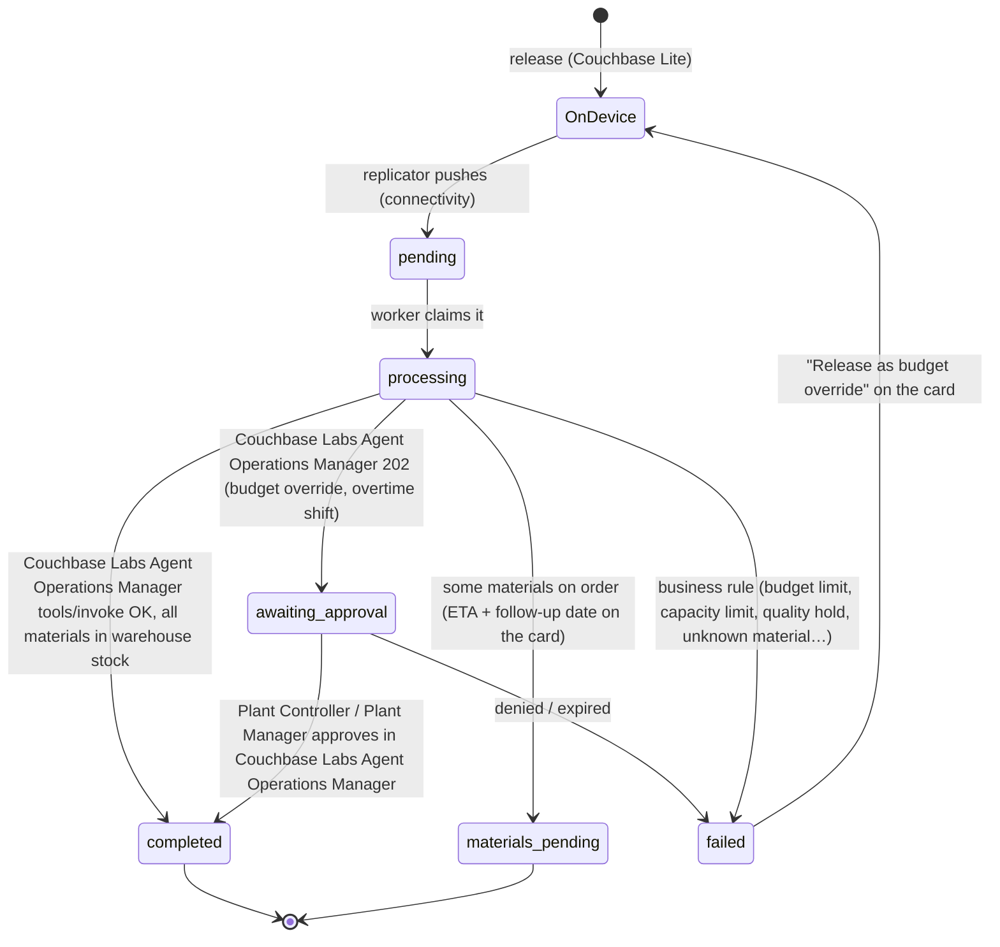

# Manufacturing Demand & Production Planning on Couchbase

A mobile app for the production planners who decide, product by product and line by line, what a plant builds this week. Every night an AI model analyzes **historical sales, market trends and supply chain data** and optimizes three things; the app puts all three in the planner's hand on the shop floor:

* **Factory schedules** - the 8-week demand forecast becomes a recommended build quantity for the week, shown next to what is scheduled and what the line can actually make. A build above capacity needs an overtime shift.
* **Inventory levels** - days of finished-goods cover against the service class's target, and a recommended safety stock that moves with forecast error and demand trend.
* **Material ordering** - days-to-stockout per material from usage and open purchase orders, supplier lead times and commodity indexes for forward buys, checked against warehouse stock and the product's material budget.

It keeps working **in a press shop with no Wi-Fi** - and in the foundry bay, the paint booth and the mezzanine stores - because every product, its forecast, inventory, alerts and this morning's production plan live on the phone in **Couchbase Lite**. Production orders are released offline and **sync back through Sync Gateway** the moment the planner has a connection.

The data comes from a **daily Databricks export** of the demand-planning model, and that is the only Databricks compute the app ever uses. Every forecast read, production plan, material lookup and assistant answer during the day is served from Couchbase (or Couchbase Lite), never from a SQL warehouse or a Model Serving endpoint. The story page counts the warehouse queries that didn't run.

The app's assistant is **registered with, and governed by, the Couchbase Labs Agent Operations Manager**:

* answers are grounded in Couchbase Labs Agent Operations Manager's **Knowledge Base** (the Production Planning Playbook and one profile document per product)
* it is registered as a Couchbase Labs Agent Operations Manager **RAG Application** (`mfg-planning-assistant`), so its queries, cache hits and cost savings show on Couchbase Labs Agent Operations Manager's *RAG Applications* page
* the context it builds for each product question is cached in Couchbase Labs Agent Operations Manager's **Context Cache** and in Couchbase, which syncs it to the phone
* LLM calls go through Couchbase Labs Agent Operations Manager's **LLM Caching** gateway
* every production order, budget override, overtime shift, standing order, supplier return and line check runs as an RBAC-checked, traced and audited Couchbase Labs Agent Operations Manager tool call, with human approval for budget overrides (the Plant Controller) and overtime shifts (the Plant Manager)

---

## How the demo opens

`https://<host>:5155/story` is **A Production Plan That Doesn't Wait for Wi-Fi**, a seven-chapter story for the room before the live app. Use ←/→ to move between chapters, **N** for talking points and ☾ for dark mode:

1. **A day on the floor.** Why planners are offline so often: press shops, foundry bays, paint booths, mezzanine stores, cold docks. It closes with Maya releasing an $18,970 material order for the HP-2200 gear pump that is $3,774 over the product's remaining budget, and raising the week's build from 900 to 1,200.
2. **What the app needs.** The three decisions the model makes (schedule, inventory, materials) and eight requirements: four for the phone, four for the AI and the data platform.
3. **The Databricks bill.** The per-request design (a warehouse query per screen, a Model Serving call per product) next to the nightly-export design. Press **Transform the stack**, or **T**, and watch "warehouse queries per day" go from 144,000 to 1.
4. **Offline-first, step by step.** The same production order in two phones, one with Couchbase Lite and one online-only. Press **Next step**, or Space.
5. **One data plane for the AI.** Databricks to Couchbase to the Couchbase Labs Agent Operations Manager Knowledge Base, RAG app and caches, and on to the phone - with live numbers from the running backend.
6. **Where the Databricks money goes.** Per-request serving vs. nightly export + Couchbase, line by line.
7. **See it run.** Links to the app and the Couchbase Labs Agent Operations Manager dashboard, plus a ten-minute demo script.

## What the demo shows

| Concept | Where you see it |
|---|---|
| **Today's floor walk and every product, on the phone** | *Today* lists the products whose plan is due for review, with the service class, scheduled run or expedite, the recommended build against the schedule, open alerts and a note on the signal at that line. *Products* is the whole plant, searchable offline. Opening a product shows the line and contacts, open alerts, this week's schedule against the model and capacity, 12 months of sales and the 8-week forecast with its drivers and market signals, inventory and safety stock, material cover, service class and budget, order history and the model's briefing - all from Couchbase Lite. |
| **Factory schedule from the forecast** | Each product's `plan::<id>` document carries `schedule`: units scheduled this week, the model's recommended build, the line's capacity, and the overtime hours needed when the recommendation is over capacity. The Production order screen starts at the recommended quantity and shows the days of cover the build leaves. |
| **Inventory levels** | Finished goods on hand, days of cover against the service class's target, safety stock and the model's recommended safety stock. Ask the assistant "How much inventory do we have and is the safety stock right?" |
| **Material ordering from Databricks** | The plan's material lines are the model's recommendations with days-to-stockout, checked against on-hand units at the plant's warehouse, the supplier lead time (long-lead items are flagged) and the product's remaining material budget. Forward-buy candidates come from the commodity and lead-time indexes. The plan re-ranks after every release. |
| **Couchbase Lite: offline and online** | Turning on *Profile → No signal* pauses replication. You can still open any product, walk the readiness checklist, set the build, pick materials, release the production order (saved as a `production_orders` document marked **On device**), and ask the assistant. Switch it off: the order syncs and comes back **Completed** (or **Materials on order** with an ETA and a follow-up date). |
| **Budget override with human approval** | The HP-2200 plan exceeds what is left of its quarterly material budget. A plain `release_production_order` fails with `reason_code: budget_limit`; releasing it as `request_budget_override` is held by Couchbase Labs Agent Operations Manager as **Awaiting approval** until the Plant Controller approves it on Couchbase Labs Agent Operations Manager's Approvals page, after which the order is released, both alerts clear and the schedule shows the new quantity. |
| **Overtime shift with Plant Manager approval** | The EH-300 enclosure's recommended build (5,200) is over its press's weekly capacity (4,600). A release at that quantity fails with `capacity_limit`; `request_overtime_shift` (11 hours) is held by Couchbase Labs Agent Operations Manager until the Plant Manager approves it, the line's capacity goes up and the full build can be released. |
| **Quality hold** | HS-612 Heat Shield is on a quality hold (customer complaint containment). Releases are refused with `quality_hold`, overrides and overtime can't lift it, and the assistant steers to logging the line check as *on hold*. |
| **Databricks offload** | `/api/status → metrics` counts every product 360, production plan, material lookup and assistant context served from Couchbase instead of a warehouse query or a Model Serving call, and turns it into dollars. Chapter 5 of the story shows it live. |
| **Registered with Couchbase Labs Agent Operations Manager** | `scripts/register_with_aom.py` (or `AOM_AUTO_REGISTER` in Kubernetes) sets up the **Manufacturing Planning Assistant** agent identity (role `production_planner`, scoped to 10 tools), the **`mfg-production-planning`** MCP server, the approval tier, and the **`mfg-planning-assistant` RAG Application**. |
| **Couchbase Labs Agent Operations Manager RAG Application** | Playbook questions ("How is safety stock set?", "How is the demand forecast built?") go to `POST /v1/agent/rag/mfg-planning-assistant/query`. The app is scoped to the one *Production Planning Playbook* document, so a generic question can never retrieve another plant's product. |
| **Knowledge Base fed by the daily export** | The loader publishes the playbook plus one *Product profile* document per product due for a plan review soon. The assistant always searches with a `document_id` filter, so a question about one product can only be grounded in **that** product's profile. |
| **Context Caching** | For product questions the assistant assembles context (the product's KB profile chunks, playbook chunks and live tool facts: schedule, inventory, material plan, alerts, warehouse on-hand, budget) and caches it in **Couchbase Labs Agent Operations Manager's Context Cache** (namespace `rag:mfg-planning-assistant:product-context`, key `<product>:<intent>:<export_date>:r<product rev>`). The next export or any release on the product changes the key, so the entry is never served stale. The same context is written to Couchbase as `ctx::<product>::<intent>`, which syncs to every planner in the plant; that copy is what the offline assistant answers from. |
| **LLM Caching** | Playbook questions contain no product data, so the second planner to ask the same question gets `LLM cache · exact hit`. Product questions go through `/v1/llm/complete` in the `rag:mfg-planning-assistant:product` namespace. |

---

## Architecture



| # | Flow |
|---|---|
| **1** | Every morning the Databricks job drops a `dt=YYYY-MM-DD` JSON Lines partition, and the loader picks up the newest one with a `_SUCCESS` marker. Databricks is done for the day. |
| **2** | The loader upserts every product, builds the production plan for every product due for a review soon, builds one floor-walk document per planner and publishes the materials catalog in Couchbase Server. The assistant reads and writes its **context cache** there, the worker reads pending production orders, and the MCP tools apply releases, schedule changes, stock and budget. |
| **3** | The loader replaces the Couchbase Labs Agent Operations Manager **Knowledge Base** documents (the playbook and one profile per product due soon), then re-scopes the **RAG Application** to the new playbook. |
| **4** | Sign-in: the backend creates the planner's Sync Gateway user (channels `planner:<id>`, `plant:<id>`, `catalog`) and mints a session. The assistant is called over `/api`. |
| **5** | **Couchbase Lite** replicates continuously with Sync Gateway. Every screen renders from the phone, and releases become `production_orders` documents saved locally, even offline. |
| **6** | Playbook questions go to the assistant's **RAG Application** in one call. Product questions check Couchbase Labs Agent Operations Manager's **Context Cache**; on a miss the assistant does document-scoped **KB retrieval**, stores the context in Couchbase Labs Agent Operations Manager and Couchbase, recalls **memory**, then calls the **LLM Caching** gateway. |
| **7** | Couchbase Labs Agent Operations Manager calls the LLM provider only on a cache miss. |
| **8** | Sync Gateway carries production orders up and results back down: releases, materials on order, cleared alerts, the new schedule, the updated budget and the re-ranked plan. |
| **9** | The worker runs each production order as the **Manufacturing Planning Assistant** agent through `POST /v1/tools/invoke`, so RBAC, tool scope, the approval tier, a trace and an audit entry are applied. |
| **10** | Couchbase Labs Agent Operations Manager calls the `mfg-production-planning` MCP server, which sets the week's schedule, issues warehouse stock, commits the budget and re-ranks the plan in Couchbase, and that syncs back to the phone (2 → 8 → 5). |

### Offline-first production order lifecycle



---

## Quick start

### 1. Browser preview in about 2 minutes (no Docker, no Couchbase Labs Agent Operations Manager)

The backend can run on an in-memory store, and the app has a browser preview engine that syncs the same documents over REST. Use this to look at the UX. Couchbase Lite needs a device build (step 3).

```bash
python3 databricks/generate_mock_dump.py            # ~100 MB export → data/databricks-dump/dt=<today>/
cd backend && python3 -m venv .venv && . .venv/bin/activate && pip install -r requirements.txt
uvicorn app.main:app --port 8200                    # STORE_DRIVER=memory by default
# new terminal
cd mobile && cp .env.example .env && sed -i '' 's/8204/8200/' .env && npm install && npx expo start --web
```

### 2. Full stack: Couchbase, Sync Gateway and Couchbase Labs Agent Operations Manager

You need Docker Desktop, and the Couchbase Labs Agent Operations Manager running on the same machine at `https://localhost:8090`, with its admin password set.

```bash
cp .env.example .env
./scripts/setup-corporate-ca.sh            # only behind a TLS-inspecting proxy (Zscaler etc.)
python3 databricks/generate_mock_dump.py   # the export the backend loads
docker compose up -d --build               # couchbase, init, sync-gateway, sg-init, backend, web
docker compose logs -f backend             # wait for "Loaded export …: … products"

python3 scripts/register_with_aom.py --admin-password '<Couchbase Labs Agent Operations Manager admin password>'
docker compose up -d --build backend       # picks up AOM_* from .env, publishes the KB, scopes the RAG app
```

Then open **https://localhost:5155/story** for the story, **https://localhost:5155** for the app in a browser, or **http://localhost:8204** for a page linking every service.

| Port | Service |
|---|---|
| `5155` | **The app in a browser** over HTTPS, behind the sign-in page (`web` service), shown inside a phone frame (add `?frame=0` for full width) |
| `8204` | Backend API + MCP server (`/mfg/mcp`); `/` lists every link |
| `4992` | Sync Gateway public, which is what phones replicate with: `ws://<host>:4992/manufacturing` |
| `127.0.0.1:4993` | Sync Gateway admin |
| `127.0.0.1:18095` | Couchbase Web Console (Administrator / password123) |

**Sign-in and HTTPS.** The browser UI (the app, the story page and everything else the `web` container serves) is on **`https://<host>:5155`** and opens on a sign-in page:

| Username | Password |
|---|---|
| `demo` | `Couchbase123!` |

Change them with `DEMO_USERNAME` / `DEMO_PASSWORD` in `.env` (Compose) or `web.auth.username` / `web.auth.password` (Helm). The container serves a self-signed certificate it generates on first start, so the browser warns once; add the address people use to `TLS_HOSTS` (Compose) so it is in the certificate, or serve a real one by mounting `tls.crt` / `tls.key` at `/etc/nginx/tls` (Helm: `web.tls.secretName`). Plain `http://` on the same port redirects to HTTPS, and `/signout` ends the session. The sign-in covers the browser UI only: the backend API and Sync Gateway ports are unchanged.

Ports are one above the telecom field service demo's backend, Sync Gateway and console ports (8203 / 4990 / 4991 / 18094), so both stacks can run side by side next to Couchbase Labs Agent Operations Manager and the other demos. Bucket and Sync Gateway database are `manufacturing`, scope `planning`; container names start with `mfg-`.

### 3. The app on a device with Couchbase Lite

Couchbase Lite is a native module, so it needs a **development build**; Expo Go can't load it. `npm install` runs `scripts/fetch-cbl-native.sh`, which fetches the `cbl-reactnative` native submodules that npm skips.

```bash
cd mobile
cp .env.example .env                       # API + Sync Gateway URLs (LAN IP for a physical phone)
npm install
npx expo run:ios -d "iPhone 16 Pro"        # or: npx expo run:android
```

The `web` service serves a prebuilt browser bundle (`web/dist.tgz`). After changing the app, rebuild it with `cd mobile && npm run export:web:docker`, then `docker compose up -d --build web`.

### 4. Kubernetes with Helm (K3s / Rancher)

`deploy/k8s/deploy.sh` deploys Couchbase Labs Agent Operations Manager (**agent-ops**) and this demo (**manufacturing-app**) onto a single-node K3s cluster without a container registry:

```bash
AOM_ADMIN_PASSWORD='<current Couchbase Labs Agent Operations Manager password>' ONLY=manufacturing ./deploy/k8s/deploy.sh              # mother
AOM_ADMIN_PASSWORD='<current Couchbase Labs Agent Operations Manager password>' TARGET=hal ONLY=manufacturing ./deploy/k8s/deploy.sh   # hal
```

`deploy/k8s/values-mother.yaml` and `values-hal.yaml` publish it on **5155 / 8204 / 4992**. With `AOM_AUTO_REGISTER=true` the backend registers itself with Couchbase Labs Agent Operations Manager (MCP server, agent, approval tier, Knowledge Base and RAG application); progress is in `/api/status` under `aom.registration`. A daily CronJob (04:30 America/New_York) drops a new mock export and the backend picks it up within five minutes.

---

## Demo script (about 10 minutes)

1. **Maya Chen** (employee **204817** / **Chen**, Peabody Fluid Power Plant, 5 products to review)
   * *Today*: HP-2200 Hydraulic Gear Pump first, 8:30, A item, **Expedite**, 2 alerts, "Build 1,200 this week (+300 vs schedule)", "Foundry bay - handhelds drop off the network". Open it: line and contacts, the two alerts (demand spike +38%, castings PO 6 days late), this week's schedule (900 scheduled, 1,200 recommended, 1,300 capacity), 12 months of sales and the 8-week forecast with drivers and market signals, 4.2 days of cover against 10, safety stock 480 → 620 recommended, 62% stockout risk, **$15,196 of material budget left**, the briefing.
   * *Profile → No signal* **on**. Back to the pump → **Open production order**: build quantity pre-set to 1,200, 2 alert tasks, a 6-step readiness checklist, 6 materials pre-filled from the model, castings flagged "runs out in ~1d", "Long-lead · 28 days" and "Only 3 on hand - 1 will go on order", total **$18,970.00 - $3,774.00 over the remaining budget**, computed on the phone. Tick the checks, **Release as budget override** → **On device**. Ask the assistant "What needs doing for this product today?" → **Answered on device · Couchbase Lite**.
   * Switch *No signal* **off**: the order syncs, Couchbase Labs Agent Operations Manager holds it → **Awaiting approval**. Approve it in Couchbase Labs Agent Operations Manager → *Approvals*; the card flips to **Materials on order** (one pallet of castings short at the Northeast warehouse - the ETA is on the card), both alerts clear, the schedule shows 1,200, the budget and history update, and the plan no longer lists what was just ordered. In Couchbase Labs Agent Operations Manager, show the trace and audit entry for `mfg-production-planning::request_budget_override`.
   * *MC-480 Motor Controller*: order controller boards ×2 → **Materials on order** (on allocation everywhere). Ask "How does a budget override work?" twice: `Context cache · hit` and `LLM cache · exact hit`. Open **sources**: the playbook.
2. **Devon Walker** (**318552** / **Walker**, Kingston Molding Plant): asks the same playbook question and gets an **LLM cache exact hit** from Maya's turn, because the playbook namespace is shared and has no product data. At EH-300 Enclosure Housing (press shop, no Wi-Fi) ask "Do I need an overtime shift for this product?" → 5,200 recommended against 4,600 capacity, about 11 hours; request it and the Plant Manager approves it in Couchbase Labs Agent Operations Manager, then release the full 5,200. Set a standing order for resin at FS-140 Fan Shroud.
3. **Sofia Alvarez** (**427190** / **Alvarez**, Fort Worth Assembly Plant): three Lone Star Tractor OEM Program products on one key-account contract. HS-612 Heat Shield is on a **quality hold**: the release is refused with `quality_hold` and the assistant steers to logging *on hold*. Log a line check at CV-31 Control Valve Assembly; the stop flips to checked on the floor walk.
4. Finish on **story chapter 5**: the counters moved because of what you just did, and every one is a Databricks query that didn't run.

---

## The Databricks export

`databricks/generate_mock_dump.py` writes the exact layout the Databricks notebook produces: Spark JSON Lines part files, `_SUCCESS`, and a `_manifest.json`.

```bash
python3 databricks/generate_mock_dump.py --export-date 2026-11-13 --target-mb 100 --parts 4
```

* **About 7,900 products** across ~130 plants (one planner each), 100 MiB, deterministic for a given `--seed` on a given Python version.
* One line is **one product at a plant**: identity and code, the line it runs on (line type, building, shift pattern, changeover, serving warehouse), plant and assigned planner, contacts, service class, material budget and quality hold (`auth`), review cadence with a note on the signal at the line, and the three inputs the use case names:
  * **historical sales** - `demand.history_12mo`, the last four weeks, the open order book and top customers
  * **market trends** - `market` signals (customer order intake, steel and resin indexes, foundry and semiconductor lead times) and the demand `drivers`
  * **supply chain data** - finished-goods `inventory`, the week's `schedule` and line capacity, material `coverage`, open planning `alerts`, the last production orders with material lines, weekly `usage` per material and 12-month material spend
* **`ml_scores`** from `mfg-demand-planning-v3.1` holds what the model decided: the 8-week forecast (`demand.forecast_8wk`) and its next-four-week total, the recommended build quantity with a reason, the recommended safety stock, shortage risk per material category, 30-day stockout risk, days-to-stockout per material, the recommended materials with a confidence each, forward-buy candidates, segment and next best action.
* Three hand-built **demo planners** and their products, with `next_review_date` pinned to the export date, are always the first rows.
* `databricks/notebooks/item_demand_plan_daily_export.py` is the production equivalent: Planning 360 joins, the sales, market-signal and MRP exception feeds, MLflow model scoring, a Delta table, and the JSON export to a Unity Catalog volume. `databricks/jobs/…job.json` schedules it daily at 04:30 America/New_York.

---

## Data model

Bucket `manufacturing`, scope `planning`. Sync Gateway replicates the first seven collections to Couchbase Lite (same scope and collection names on the phone). A planner's SG user gets the `planner:<id>`, `plant:<id>` and `catalog` channels.

| Collection | Document | Channel | Written by | Notes |
|---|---|---|---|---|
| `products` | `product::<id>` | plant | loader, actions | The export row + `rev` (bumped on every release, budget change, standing order, overtime shift, line check) |
| `planners` | `planner::<id>` | planner | loader, actions | Plant, today's floor walk (stops in order, checked flags), totals |
| `production_plans` | `plan::<product>` | plant | personalization | Schedule vs. model vs. capacity, alert and readiness tasks, materials with warehouse on-hand, budget check, briefing |
| `production_orders` | `order::<planner>::<uuid>` | planner | **the phone** (create), worker (status) | Offline-first queue for every planning action. The sync function allows `requireUser(planner_id)`, `status: pending` and creation only |
| `assistant` | `chat::<planner>` | planner | assistant | History + answers reusable offline (keyed by product + question) |
| `context_cache` | `ctx::<product>::<intent>`, `ctx::<planner>::playbook_<intent>` | plant / planner | assistant | Phone copy of the **Context Cache** entry also held in Couchbase Labs Agent Operations Manager |
| `catalog` | `catalog::v1` | catalog | loader | Materials, service classes, order types, readiness checklists per line type, warehouses, FAQ |
| `inventory` | `inv::<warehouse>` | — | actions | On-hand units per material per warehouse (CAS updates). Server only |
| `lookups` | `login::…`, `kbdoc::…`, `load_state` | — | loader | Login index, KB document ids, load status. Server only |

The tools on the `mfg-production-planning` MCP server are `get_product_context`, `get_production_plan`, `search_materials`, `quote_production_order`, `release_production_order`, `request_budget_override` (approval required), `set_standing_order`, `create_supplier_return`, `log_line_check` and `request_overtime_shift` (approval required). Every tool takes the calling `planner_id`, and a product can only be planned by the planner whose plant it belongs to.

---

## Configuration

Backend variables go in `.env` (see `.env.example`); `docker-compose.yml` sets the infrastructure ones.

| Variable | Default | |
|---|---|---|
| `STORE_DRIVER` | `memory` (compose: `couchbase`) | `memory` keeps products due for a review within `MEMORY_WINDOW_DAYS`, plus the demo plants |
| `AOM_URL`, `AOM_AGENT_API_KEY` | — | Agent identity, written by `register_with_aom.py` |
| `AOM_ADMIN_USERNAME`, `AOM_ADMIN_PASSWORD` | — | Used only to publish KB documents |
| `KB_WINDOW_DAYS`, `KB_PROFILE_LIMIT` | `7`, `150` | Which products get a KB profile each day |
| `CONTEXT_CACHE_TTL_SECONDS` | `21600` | Upper bound; the export date and product rev invalidate it sooner |
| `RAG_APP_ID` | `mfg-planning-assistant` | Couchbase Labs Agent Operations Manager RAG Application id; `RAG_APP_ENABLED=false` skips it |
| `DBX_COST_PER_QUERY_USD` | `0.035` | Illustrative cost per warehouse / Model Serving call behind the story's "spend avoided" counter |
| `DEMO_TODAY` | export's `export_date` | Keeps "today's floor walk" stable whenever you demo |
| `SG_PUBLIC_URL` | — | Replication URL handed to phones |

App variables (`mobile/.env`): `EXPO_PUBLIC_API_URL`, `EXPO_PUBLIC_SG_URL`, `EXPO_PUBLIC_DB_ENGINE` (`auto` · `cbl` · `preview`).

---

## Tests

```bash
cd backend && pytest -q          # 18 tests
cd mobile && npm run typecheck
```

`test_demo_flows.py` covers the floor walk and plant sync, production plans (schedule vs. model vs. capacity, inventory, alerts first, then the checklist), the budget-limit failure and the override that releases the order, raises the schedule and clears the alerts, short warehouse stock as materials on order, the capacity-limit failure and the overtime shift that lifts it, the assistant's context cache, forecast, inventory and playbook answers, quality holds, plant authorization, standing orders, line checks, supplier returns, push authorization and the Databricks offload counters. `test_aom_integration.py` runs the backend against `tests/fake_aom.py`, which has the same routes and shapes as Couchbase Labs Agent Operations Manager. `test_aom_bootstrap.py` starts the backend with `AOM_AUTO_REGISTER` against a fresh fake Couchbase Labs Agent Operations Manager.

---

## Repository layout

```
backend/            FastAPI API, MCP server, loader, worker, assistant (Python)
  app/catalog.py        materials, line types and readiness checklists, service classes, warehouses, plants (shared with the generator)
  app/personalization.py  the production plan per product: schedule vs. model vs. capacity, tasks, materials to order
  app/actions.py        release / budget / overtime / standing order / supplier return / line check logic behind every tool
  app/assistant.py      intent → Couchbase Labs Agent Operations Manager RAG app (playbook) | Couchbase Labs Agent Operations Manager Context Cache → KB + memory + LLM cache (product) → actions
  app/knowledge.py      the Production Planning Playbook and product profile documents
  app/loader.py         daily export → Couchbase (products, production plans, floor walks) + Couchbase Labs Agent Operations Manager Knowledge Base
  app/worker.py         offline-first production orders → Couchbase Labs Agent Operations Manager tools/invoke
mobile/             Expo app (Couchbase Lite engine + browser preview engine)
databricks/         mock export generator, PySpark notebook, daily job
couchbase-init/     bucket / scope / collections / indexes
sync-gateway/       bootstrap + database config with per-collection sync functions
scripts/            register_with_aom.py, setup-corporate-ca.sh
web/                nginx image serving the browser build of the app and the story page
helm/manufacturing-app/   Helm chart for the demo
deploy/k8s/         deploy.sh + values for the K3s nodes
docs/images/        architecture diagram and the Couchbase logo files
```

## Notes

* **Brand.** The palette is Couchbase red (`#EA2328`) on white with the brand's near-black for dark surfaces. `docs/images/couchbase-logo.svg` is the logo file from Couchbase's own `couchbase/docs-ui` repository, unmodified; the reversed (white wordmark) and mark-only variants and the PNGs in `mobile/assets/images` are generated from it. The manufacturer, plants, products, planners, part numbers, costs, alerts and policies are fictional demo data, and suppliers and customers are deliberately generic.
* **The model.** The forecast, build quantities and material recommendations in the mock export are generated with simple rules that behave plausibly; they stand in for the output of a real demand-planning model and are not one. The app only depends on the export's schema.
* **Databricks numbers.** The offload counters are a demo instrument: they count reads the app served from Couchbase that a per-request design would have sent to a SQL warehouse or Model Serving endpoint, at a flat `DBX_COST_PER_QUERY_USD`. Replace the rate with the customer's blended per-query cost before quoting a figure.
* **Playbook content.** The policies in `backend/app/knowledge.py` (safety stock, build quantity, overtime, budget overrides) are plausible illustrations for a demo, not a planning standard.
* **Couchbase licensing.** Couchbase Server EE and Sync Gateway EE images run under the free developer license for dev and test. Shipping Couchbase Lite with encryption requires an Enterprise license.
